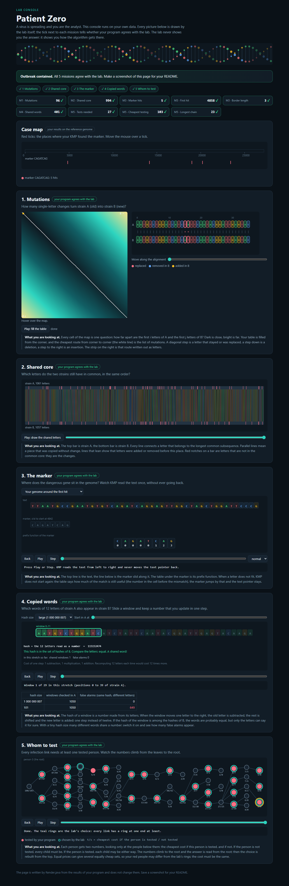

# Assignment 4. Patient Zero

- Student ID: 252342
- Name: Sandzhar Fazyl
- Group: SE-2536

## Run

Use JDK 17 or newer. From the project root, run:

```text
java tools/Check.java
java -cp out Main
```

`Check` compiles the project and checks the `tiny`, `small`, and `dense` examples. `Main` reads the four files in `data/` and writes the lab console to `output/outbreak.html`.

## Program output

```text
Mutations: 96
Shared core: 994
Marker hits: 5
First hit: 4858
Border length: 3
Shared words: 401
Tests needed: 27
Cheapest testing: 103
Longest chain: 23
```

## Questions

**Mission 1.** The cell `d[i][j]` is the fewest edits needed to turn the first `i` letters of A into the first `j` letters of B. I take the minimum of the cell above plus a deletion, the cell to the left plus an insertion, and the diagonal plus one if the letters differ. The first row and column give the cost of building or removing a prefix one letter at a time.

**Mission 2.** A common subsequence keeps the letters in order and can skip letters, while a common substring has to be one continuous block in each strain. In my data there are 462 equal letters at the same index, but the shared core has length 994 because an insertion or deletion can shift a matching stretch to another index.

**Mission 3.** The prefix function gives the length of the longest proper prefix that is also a suffix for each prefix of the marker. On a mismatch KMP reuses a shorter suffix of what has already matched and keeps the text pointer in place until it can continue forward. My marker `CAGATCAG` has a border of length 3 because its longest proper prefix that also ends the marker is `CAG`.

**Mission 4.** Two different windows can produce the same hash, so I compare their letters before counting a match. When many different windows share a hash, an A window can make the program check many candidates from B and spend up to `k` letter comparisons on each candidate.

**Mission 5.** The two states are the cheapest cost in a subtree when its root is tested and when its root is skipped. If the root is tested, I pay its cost and take the cheaper state for each child, while skipping the root forces every child to be tested. In a star with a center costing 9 and two leaves costing 1 each, testing both leaves is cheaper than testing the person with the most links.

## AI use

I used ChatGPT (Codex) to plan the assignment, implement the Java algorithms, run the checks and benchmark, prepare the lab console screenshot, and draft this report.

## Timing (Mission 7)

Windows, JDK 25.0.2. Each measurement is the average of three runs from `java -cp out Bench`.

| Test | Input size | Time (ms) |
|---|---:|---:|
| Naive search | 20,000 | 144.9 |
| Naive search | 40,000 | 235.2 |
| Naive search | 80,000 | 448.4 |
| KMP | 20,000 | 6.5 |
| KMP | 40,000 | 3.6 |
| KMP | 80,000 | 1.1 |
| Edit distance | 500 | 18.1 |
| Edit distance | 1,000 | 20.9 |
| Edit distance | 2,000 | 61.3 |
| Edit distance | 4,000 | 236.7 |

With the marker length fixed, doubling the text multiplied the naive search time by 1.62 and then 1.91. KMP took only a few milliseconds, and the times decreased across the three sizes, likely because the JVM was still warming up. The edit distance time grew by factors of 1.15, 2.93, and 3.86, with the last doubling close to the fourfold growth of the DP table.

## Complexity

`n` and `m` are the lengths of the two strings. For KMP, `m` is the marker length and `h` is the number of hits. For Rabin-Karp, `k` is the window length, `wA` and `wB` count the windows in A and B, and `c` counts the candidate window pairs compared. `v` is the number of people in the tree.

| Algorithm | Time | Extra space | Assumptions |
|---|---|---|---|
| Edit distance | O(nm) | O(nm) | Full table, constant work per cell. |
| LCS | O(nm) | O(nm) | Full table, constant work per cell. |
| Prefix function and KMP | O(n + m) | O(m + h) | Includes the prefix array and the list of all hit positions. |
| Rabin-Karp | O(n + m + kc) with expected constant-time hash lookups. Worst case O(n + m + k × wA × wB). | O(wB) | A rolling update is O(1). Exact verification takes up to O(k) per candidate pair. |
| Tree DP and longest chain | O(v) | O(v) | The tree has v − 1 edges. Space includes the DP arrays, result, and recursion stack. |

## Lab console


